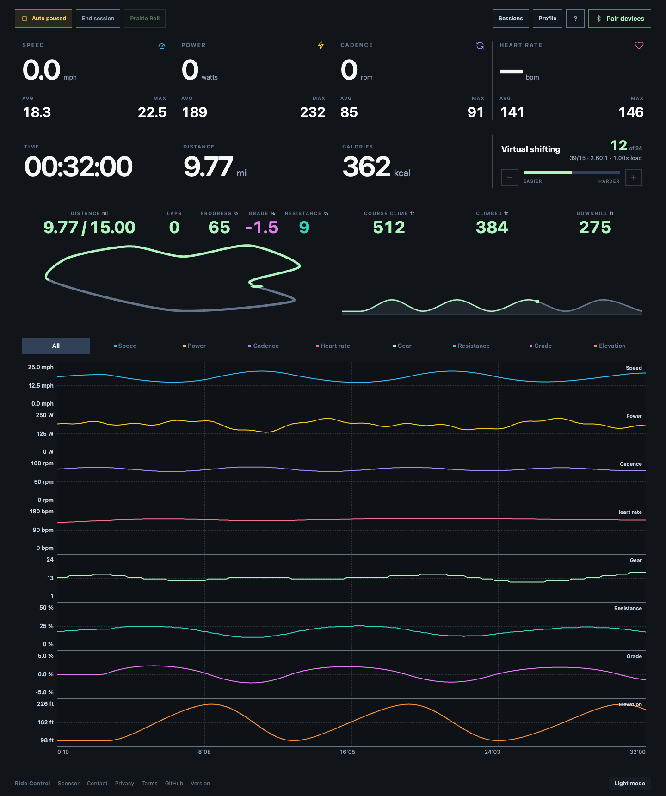
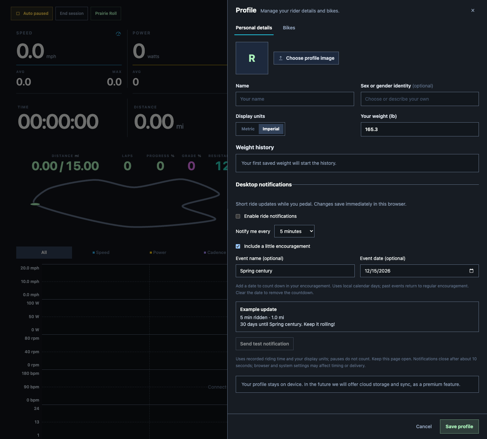
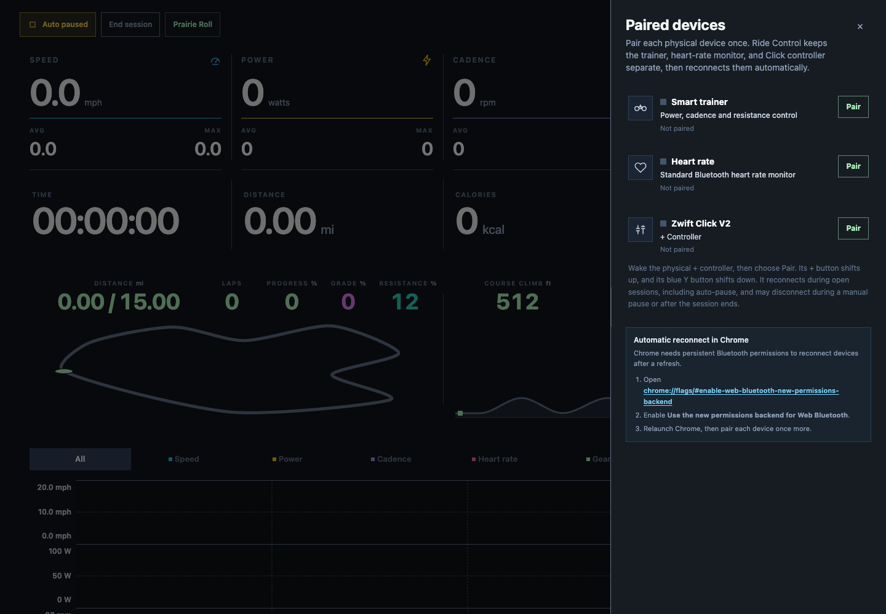
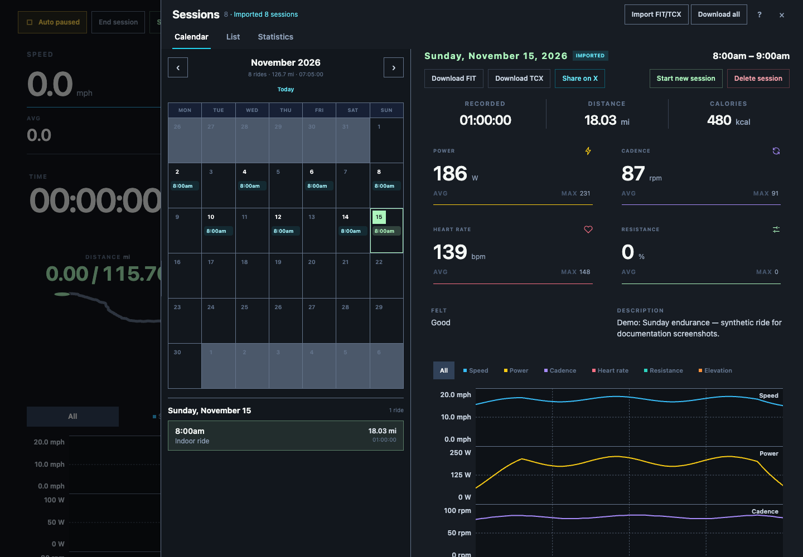
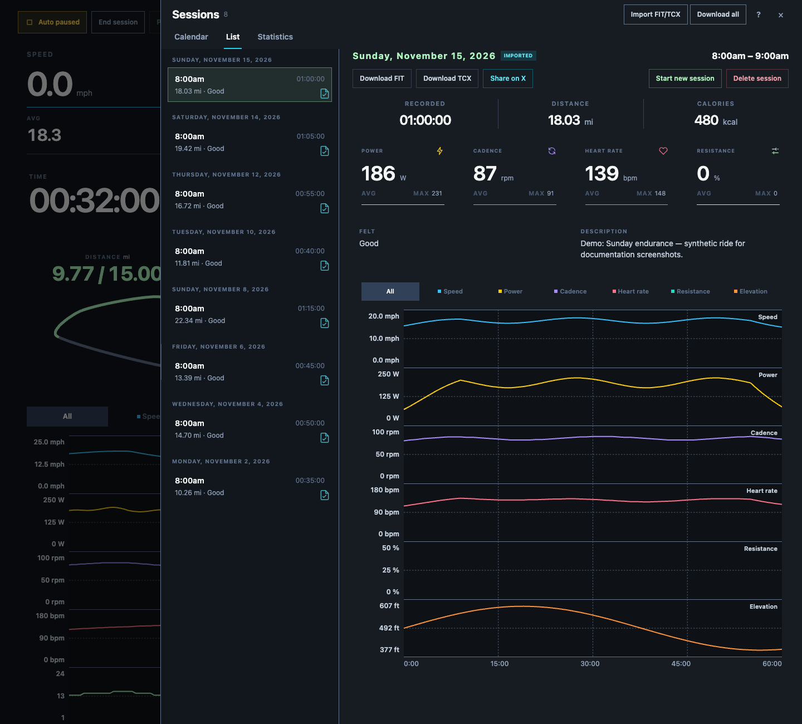
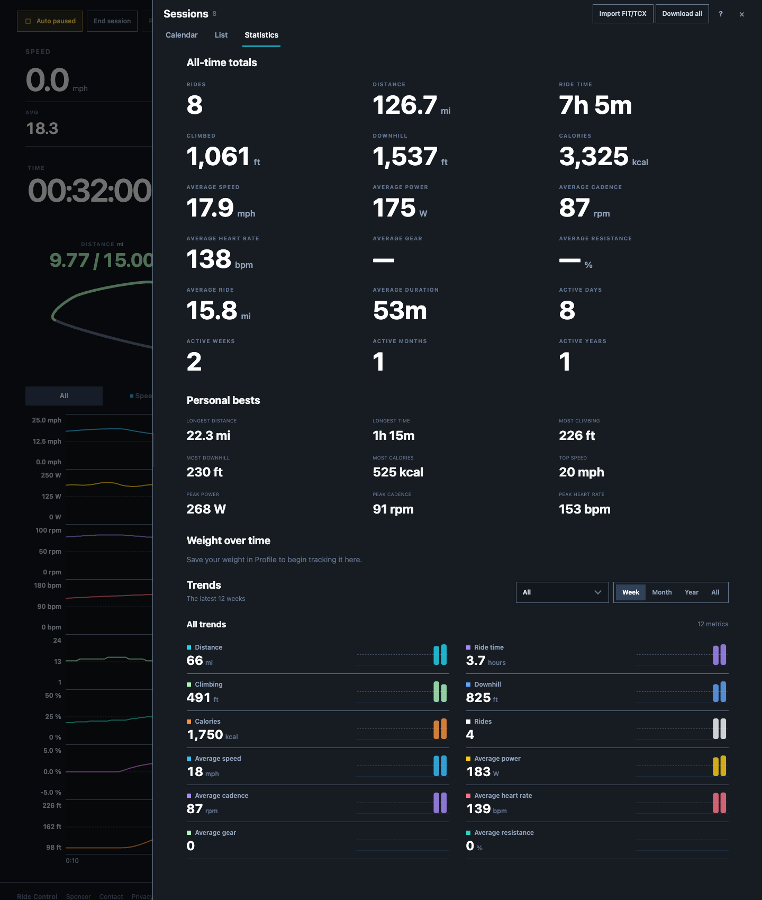
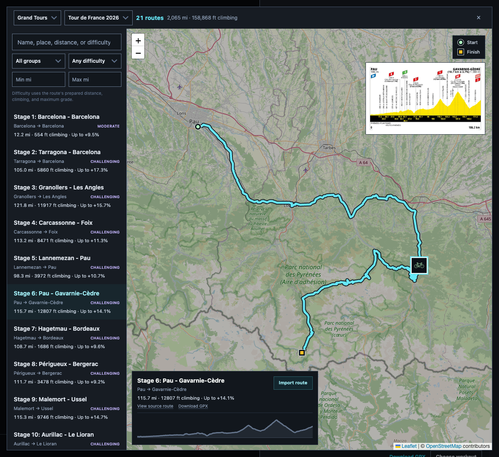

# Ride Control

Control your indoor bike trainer from Google Chrome. No account required; your ride data stays in your browser.

**[Open Ride Control](https://ridecontrol.xyz)**

- Connect Bluetooth FTMS trainers, heart-rate monitors, and supported shifting controls.
- Ride terrain workouts or import GPX routes, with virtual shifting and live ride metrics.
- Save, review, export, and resume sessions.
- Customize ride reminders, motivational messages, and event countdowns in your profile.



*Demo data; ride paused.*

<details>
<summary>Profile and desktop notification settings</summary>



</details>

<details>
<summary>Device pairing</summary>



</details>

<details>
<summary>Sessions calendar</summary>



</details>

<details>
<summary>Sessions list</summary>



*Demo data.*

</details>

<details>
<summary>Sessions statistics</summary>



*Demo data.*

</details>

<details>
<summary>Tour de France route</summary>

Tour de France 2026, Stage 6: Pau–Gavarnie-Cèdre, in the route browser.



</details>

## Run locally

Use Bun 1.4.4 and Node.js 26.13.1:

```sh
bun install --frozen-lockfile
bun run dev
```

Open `http://localhost:4200` in Google Chrome. Bluetooth requires a supported device and permission to connect; see [compatibility and reconnect setup](docs/bluetooth.md).

## Documentation

- [Features and behavior](docs/features.md)
- [Architecture](docs/architecture.md)
- [Development and deployment](docs/development.md)
- [Refreshing screenshots](docs/screenshots.md)

## License

Copyright (C) 2026 Ride Control. [GNU GPL v3](LICENSE).
